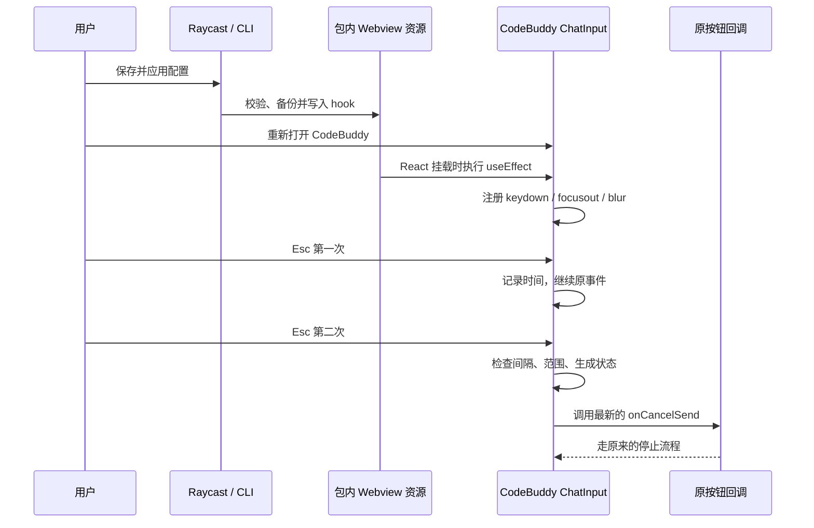

# CodeBuddy：按钮定位、注入与触发

本文对应已分析的 CodeBuddy CN 1.106.1 / genie 3.10.0，回答三个问题：代码怎么进入应用、怎么确定目标按钮的事件、安装后由谁监听和触发。

## 1. 快捷键代码怎么注入

macOS 的 `.app` 是目录包。这份 CodeBuddy 的聊天实现以打包 JavaScript 形式保存在：

```text
Contents/Resources/app/extensions/genie/
  package.json
  out/extension/index.js
  out/webviews/main.942dbf9a.chunk.js
```

安装器先读取 Webview 的 `main` 资源，核对构建和原始字节摘要，在内存中生成候选代码、验证还原关系并解析完整 JS 的语法。正式应用还会重新检查、保存原文，然后在 `ChatInput` 函数体内的已验证位置插入代码。它修改的是应用下次加载的磁盘资源。

插入位置的当前源码锚点是：

```js
const{setNavigationAllowed:Tn,navigateToInputContextLast:In}=
```

锚点必须唯一，而且文件必须符合 profile 指定的摘要；没有“搜索到类似文本就打补丁”的回退。CodeBuddy 更新后需要重新确认。

**插入在函数体内很关键。** `ChatInput` 已经通过参数拿到停止按钮的回调，并持有生成状态和输入区域引用。新代码处于同一词法作用域，可以直接使用这些变量：

| 当前压缩变量 | 在该组件中的含义          | 用途                       |
| ------------ | ------------------------- | -------------------------- |
| `Ce`         | 解构得到的 `onCancelSend` | 调用停止按钮原回调         |
| `le`         | `isStreaming`             | 判断是否正在生成           |
| `Re`         | 输入区 DOM ref            | 确定可见性和监听范围       |
| `Ae`         | 查找聊天容器的已有函数    | 面板范围监听               |
| `m`          | React 模块                | 使用 `useRef`、`useEffect` |
| `r`          | 此模块的打包器 require    | 获取已有新建对话服务       |

如果仅在文件末尾追加一个全局脚本，它拿不到 `Ce` 这样的函数局部变量。当前做法利用已有作用域，不需要把私有对象暴露到 `window`。

安装步骤由共享 `core/engine.ts` 处理；位置和生成代码由 `apps/codebuddy-cn/profile.ts`、`hook.ts` 拥有。替换是同目录临时文件写入后重命名，再验证目标摘要；应用需先退出并在修改后重新打开。

## 2. 原按钮关联事件怎么分析出来

这次使用的是**包内静态分析与调用链追踪**，没有对原生机器码反汇编，也没有在调试器中拦截鼠标事件。

首先通过 REA CLI 分析内置扩展清单，选择的源文件是 `package.json`。当时的 Evidence ID 为：

```text
ev_bec4bab218bdebb715ac12ba2532a499ae24b8f0f6b842528307163ce36a9f3a
```

这份 REA Evidence 只覆盖选中的清单解析，**不代表 REA 自动追踪了后面的全部函数链**。处理函数关联来自额外读取打包 JS、搜索符号和检查相邻代码。

### 顶部“＋”：从菜单声明追到 handler

扩展清单的 `contributes.menus["view/title"]` 将新建按钮声明为：

```text
tencentcloud.codingcopilot.chat.startNewChat
```

同一清单声明了对应的 command 和图标。随后在扩展端 `out/extension/index.js` 中搜索 `chat.startNewChat`、`START_NEW_CHAT`、`StartNewChatCommand`，可以连起：

```text
view/title 的新建按钮
  → tencentcloud.codingcopilot.chat.startNewChat
  → CommandRegistry 注册的 handler
  → StartNewChatCommand.handler()
  → 获取聊天焦点、确保 RPC 就绪
  → ChatViewService.activatePage({path: "/", params: {newConversation: true}})
```

另外，Webview 已有 `NewChatViewServieImpl.startNewChat()`。检查其代理与扩展端实现后，可以确认它最终也会执行上述 command，所以补丁使用这条已有桥接链路。

用户原有的 IDE 快捷键包含局部 `view` 上下文条件。调查时将条件放宽，但没有键盘运行日志证明这是无响应的唯一原因；Webview hook 的设计是绕过 IDE 的快捷键匹配，仍调用原应用服务。

### 底部停止：沿 React props 逐层追踪

先搜索停止图标 `IconStop`，看到它位于 `SendButton`：生成中显示停止图标，并将点击 handler 从发送回调切换为取消回调。将压缩变量改成说明性名称后，等价关系是：

```js
// 说明性伪代码，表达原资源中的分支关系。
const onClick = loading ? onCancel : onSend;
const icon = loading ? StopIcon : SendIcon;
```

接着向调用处追踪 props：

```text
SendButton.onClick（生成中）
  → SendButton.onCancel
  → ChatInput 的 onCancelSend（该构建中变量为 Ce）
  → CBChatWrapper 传入的取消回调（该构建中调用 vi）
  → 暂停消息队列、更新界面状态
  → controller.cancelPrompt({sessionId})
  → ChatInputBusinessService.stopRequest(conversationId)
  → ChatViewService.abort(conversationId, requestId)
  → 通过已有 RPC 到扩展端 ChatService.abortSession()
```

`stopRequest` 会读取该会话的 request ID，并发送 STOP 状态；扩展端取消路径包含停止 agent session。追踪到这里，才能知道“停止”不只是换一个图标或取消一次 HTTP 请求。

截图中底部按钮处于空闲发送态；源码里的 `loading` 分支说明它在生成时切换为停止态。截图用于确认 UI 位置，**不会单独证明 handler 的身份**。

最终选择复用 `Ce`，而不是重写上述取消流程：它已经是按钮在这一层接收的完整行为入口。

## 3. 安装后由谁监听、怎么触发

执行端是 **CodeBuddy 自己的 Webview JavaScript 上下文**。Raycast 负责配置和安装，不负责持续监视键盘，也不需要在后台轮询。



监听代码核心类似下面的简化示例，完整实现见 `apps/codebuddy-cn/hook.ts`：

```js
useEffect(
  () => {
    const handleKeydown = (event) => {
      // 检查焦点范围、可见性、输入法、长按、修饰键与生成状态。
      // 第二次 Esc 在配置间隔内时，调用已有取消回调。
    };
    root.addEventListener("keydown", handleKeydown);
    return () => root.removeEventListener("keydown", handleKeydown);
  },
  [/* 组件已有的稳定依赖 */],
);
```

项目化版本用 `useRef` 保留第一次 Esc 的时间，并在每次 React 渲染时更新其中的生成状态和取消函数。这避免流式输出频繁重渲染时丢失按键序列，或调用旧闭包。`useEffect` 在卸载时清理监听器。

触发顺序：

1. 事件来自所选面板或输入区域，输入区可见。
2. 事件未被页面消费，不在输入法组合中，也不是长按重复。
3. 第一次无修饰 Esc 记下单调时钟时间，不拦截事件。
4. 第二次在默认 500ms 内，并且仍在生成，才消费事件并调用当前停止回调。
5. 请求未完成时的重复触发被 in-flight 标志抑制；成功或失败后释放。

新建对话匹配所配置的组合键后，从当前模块获取现有 `NewChatViewServie`，调用 `startNewChat()`。同样只在所选聊天范围内响应。

配置会被嵌入生成的资源；**不是实时监听 `settings.json`**。只保存表单不会改变应用，修改设置需要重新应用并重新打开 CodeBuddy。

## 证据与验证边界

- 清单与打包代码建立的是静态声明、变量流向和函数调用关系，不等于执行到了每一条分支。
- 用户已实际反馈最初的 Esc/Esc 临时补丁有效。
- 项目化版本有事件模拟、重渲染、回调错误、临时目录安装、重复应用及字节恢复测试。
- 新 UI、项目化 hook 与真实模型会话的端到端验收仍需单独完成。
- 这些变量和私有服务属于当前构建，不是其他应用或下一版本的公共 API。

## 版本变化时如何处理

`preflight` 是独立的只读入口，可以先查看完整的静态检查报告。版本号、原始摘要、锚点、补丁内容或语法不符合时会拒绝应用；即使名字相同，也不会猜测沿用 `Ce`、`le` 等变量。

对于当前已验证构建，完整原文摘要约束了函数作用域和变量引用的已分析上下文。对于新构建，需要重新确认按钮回调和注入位置，增加 profile 并做运行验收。单独找到相同锚点或通过 JS 语法检查，不能证明新构建里的按钮行为一致。

预检查不会运行 JavaScript，也不会打开模型会话测试停止按钮。其成功结论是“静态兼容”，不是“运行行为已验证”。

## ⌘I 与全局焦点

最初绑定 `coding-copilot.webviews.chat.focus`，但用户反馈输入框聚焦失败。已改为专用命令 + Webview 显式请求/确认，并通过 `runCommands` 兼容默认终端分发；详细调用链、资源摘要、迁移与验证限制见 [聚焦修复记录](codebuddy-focus-investigation.md)。
